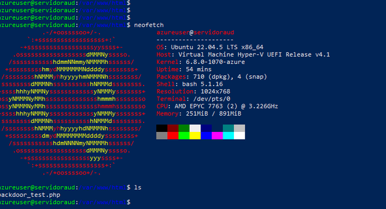
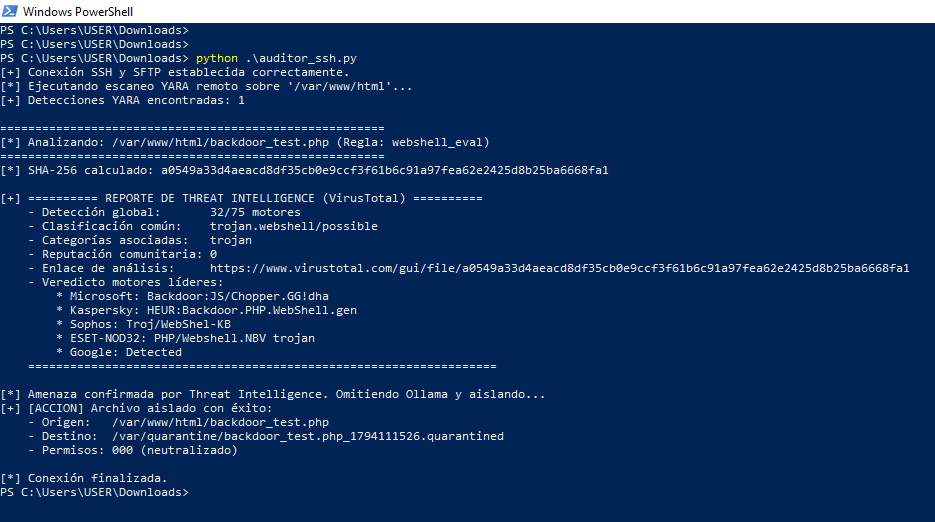

# 🛡️ Hybrid SOAR Agent: YARA + Threat Intel + Local LLM Triage

Sistema automatizado de detección, análisis heurístico y contención activa (SOAR) para servidores web Linux. Combina escaneo por firmas en el host perimetral, verificación de reputación mediante **VirusTotal API v3**, triage semántico con un **LLM local (Qwen2.5-Coder:7B)** y aislamiento forense inmediato.

---

## 📌 Arquitectura del Sistema

El proyecto separa el entorno objetivo en la nube de la inteligencia analítica local, eliminando costos por tokens en la nube y garantizando el aislamiento seguro de las muestras:
[ Azure VM (Ubuntu 22.04) ]
│
├── 1. Escaneo perimetral con YARA (/var/www/html)
│
▼  (Conexión segura SSH/SFTP en memoria)
[ Estación Local (Analista) ]
│
├── 2. Cálculo de Hash SHA-256 (en RAM, sin guardar en disco)
├── 3. Filtro rápido: Consulta VirusTotal v3 (Threat Intel)
│      ├─ ¿Conocido (≥2 detecciones)? ──► [Cuarentena Inmediata]
│      └─ ¿Desconocido / Hash 404? ────► Continúa a IA
│
├── 4. Triage heurístico: Ollama (Qwen2.5-Coder:7b)
│      └─ Inferencia semántica + JSON estructurado
│
▼  (Respuesta activa remota vía SSH)
[ Azure VM (Ubuntu 22.04) ]
└── 5. Remediación: Reubicación a /var/quarantine/ + chmod 000
## 📸 Demostración y Capturas

### 1. Entorno del Servidor (Azure VM)

*Entorno objetivo alojado en Azure (`Ubuntu 22.04 LTS`).*

### 2. Detección, Threat Intel y Triage con IA en Acción

*Detección de artefacto malicioso, extracción de telemetría desde VirusTotal y veredicto estructurado.*

### 3. Aislamiento y Cuarentena Forense
*Neutralización remota del artefacto: permisos `000` y preservación de evidencia.*

---

## 🚀 Flujo de Trabajo

1. **Escaneo perimetral (YARA):** El orquestador ejecuta YARA remotamente en la ruta `/var/www/html/` buscando patrones de webshells (`eval`, `base64_decode`, ejecuciones de sistema).
2. **Extracción segura en memoria:** Si hay coincidencias, el código sospechoso se descarga vía **SFTP directamente a la memoria RAM** del analista, previniendo ejecuciones accidentales en el host local.
3. **Capa 1 - Threat Intelligence (VirusTotal):** Se genera el SHA-256 del binario. Si los motores antivirus comerciales lo confirman como malware, se aísla de inmediato sin gastar ciclos de GPU/CPU local.
4. **Capa 2 - Triage asistido por IA (Ollama):** Si el artefacto es desconocido (código a medida o altamente ofuscado), el modelo analiza la intención del código y devuelve un veredicto técnico en formato JSON.
5. **Respuesta activa:** Se mueve el archivo a `/var/quarantine/`, se le añade marca temporal y se le revocan permisos con `chmod 000`.